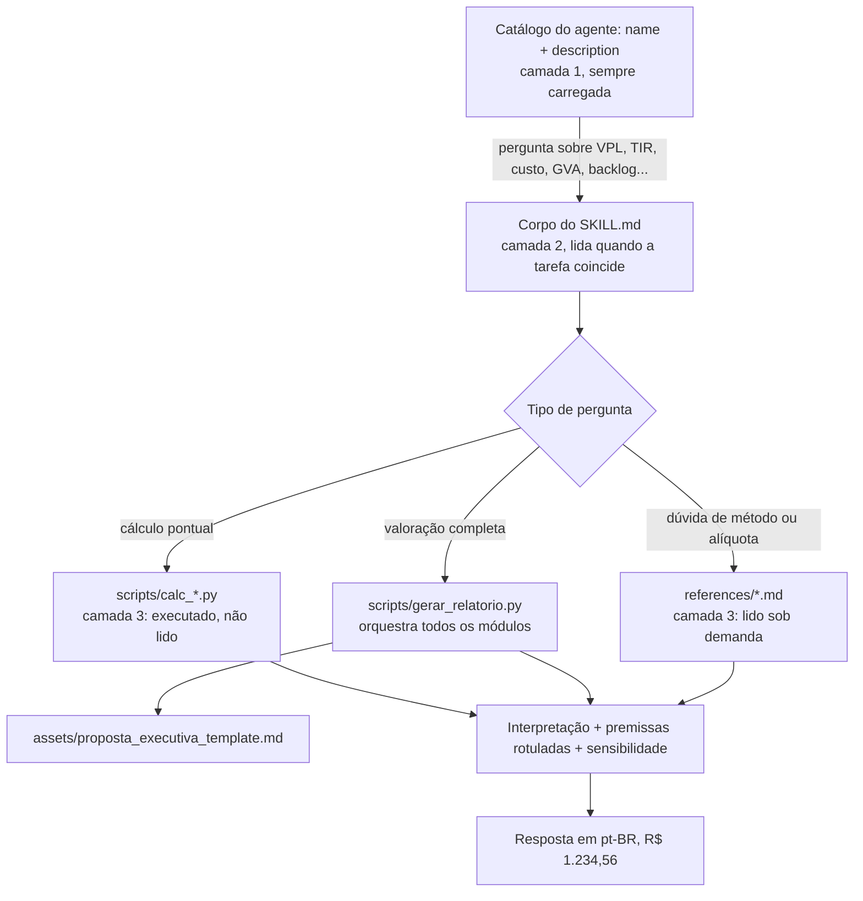
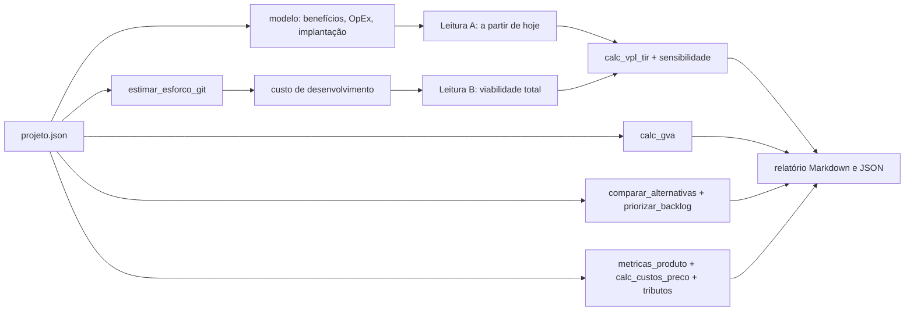

# Engenharia Econômica Agêntica: skill `engenharia-economica-software`

Skill de IA, no padrão aberto **Agent Skills**, que ajuda líderes técnicos, Product Owners e desenvolvedores a **calcular, projetar e defender a viabilidade financeira e o valor de projetos de software**: valor do dinheiro no tempo, TMA, fluxo de caixa, VPL, TIR, Payback, CAC, LTV, depreciação e tributos, custo e preço, GVA por sprint, sensibilidade, decisões de arquitetura e priorização de backlog. Todos os números saem de scripts Python determinísticos (somente biblioteca padrão), testados com valores clássicos de livro.

**Autores:** Gabriel Viana Nunes e João Vítor de Alencar Fraissat Mamede
**Curso:** Engenharia de Software, Faculdade SENAI Fatesg. **Componente curricular:** Engenharia Econômica. **Docente:** Msc. Ujeverson Tavares Sampaio.
**Atividade:** "Engenharia Econômica Agêntica: Valoração e Viabilidade de Projetos de Software com Agent Skills" (entrega em 24/11/2026).

## Sumário

1. [Propósito e público](#propósito-e-público)
2. [Plataformas suportadas](#plataformas-suportadas)
3. [Instalação, carregamento e permissões](#instalação-carregamento-e-permissões)
4. [Como a skill funciona](#como-a-skill-funciona)
5. [Estrutura do repositório](#estrutura-do-repositório)
6. [Exemplos de prompts de acionamento](#exemplos-de-prompts-de-acionamento)
7. [Uso direto dos scripts](#uso-direto-dos-scripts)
8. [Demonstração prática: valoração do TCC](#demonstração-prática-valoração-do-tcc)
9. [Testes, validação do YAML e avaliações](#testes-validação-do-yaml-e-avaliações)
10. [Cobertura das Aulas 1 a 12](#cobertura-das-aulas-1-a-12)
11. [Limitações](#limitações)
12. [Mini workshop de 24/11](#mini-workshop-de-2411)
13. [Créditos e licença](#créditos-e-licença)

## Propósito e público

Decisões de engenharia (on-premises ou nuvem, manter ou refatorar, construir ou comprar, o que entra na próxima sprint) são decisões econômicas. Esta skill empacota os métodos das Aulas 1 a 12 em um fluxo que o agente segue de forma repetível:

- **Para quem:** líderes técnicos, Product Owners, desenvolvedores e estudantes que precisam justificar investimento em software com números defensáveis.
- **O que entrega:** respostas pontuais (por exemplo, "qual a TIR deste fluxo?") e relatórios completos de valoração com sumário executivo, premissas rotuladas, fluxo de caixa, VPL, TIR, Payback, GVA, modelo de negócio, sensibilidade e riscos.
- **Por que scripts:** modelos de linguagem erram aritmética financeira, confundem taxa mensal com anual e inventam TIR onde ela não existe. Os scripts devolvem números exatos e status explícitos (por exemplo, "múltiplas TIRs").

## Plataformas suportadas

A skill é **genérica** (padrão Agent Skills: pasta com `SKILL.md`, `scripts/`, `references/`, `assets/`) e foi **testada no Claude Code**. A tabela separa o que foi testado do que é compatível por especificação.

| Plataforma | Como carregar | Situação |
|---|---|---|
| Claude Code (CLI, desktop, IDE) | Skill de projeto em `.claude/skills/` (já incluída) ou pessoal em `~/.claude/skills/` | **Testado** |
| Claude.ai e Cowork | Upload do pacote `.skill` na área de Skills das configurações | Compatível por especificação, não testado |
| Harnesses que leem `.agents/skills/` (padrão aberto) | Abrir o repositório; a skill está em `.agents/skills/engenharia-economica-software/` | Compatível por especificação, não testado |
| Gemini CLI | Se a versão suportar Agent Skills, copiar a pasta para o diretório de skills; senão, referenciar o `SKILL.md` no `GEMINI.md` do projeto | Compatível por especificação, não testado |
| ChatGPT Codex (CLI) | Se a versão suportar Agent Skills, copiar a pasta para o diretório de skills; senão, referenciar o `SKILL.md` no `AGENTS.md` | Compatível por especificação, não testado |
| GitHub Copilot (agente) | Referenciar o `SKILL.md` em `.github/copilot-instructions.md` ou usar a pasta de skills do agente, se disponível | Compatível por especificação, não testado |
| Cursor e Roo Code | Criar uma regra de projeto que aponte para o `SKILL.md` (ou colar seu conteúdo) | Compatível por especificação, não testado |
| DeepSeek e chats sem execução de código | Colar o `SKILL.md` como instrução e anexar `references/formulas.md`; os scripts precisam ser rodados pelo usuário no terminal | Uso manual |

Em qualquer plataforma, a skill precisa de **Python 3.9 ou superior** e de **permissão para executar comandos** (o agente roda `python scripts/...`). Sem execução de código, ela ainda orienta o método e as fórmulas, mas os números devem ser calculados pelo usuário com os mesmos scripts.

## Instalação, carregamento e permissões

### Pré-requisitos

- Python 3.9 ou superior (`python --version`). Nenhuma biblioteca externa.
- Git, para clonar o repositório.

```bash
git clone <url-deste-repositorio> skill-engenharia-economica-software
cd skill-engenharia-economica-software
python -m unittest discover -s tests      # deve terminar em OK
python scripts/validate_skill.py          # deve terminar com 0 erros
```

### Claude Code (testado)

**Opção 1, skill de projeto (já pronta):** abra o Claude Code na raiz do repositório. A cópia em `.claude/skills/engenharia-economica-software/` é carregada automaticamente. Confirme perguntando "quais skills você tem disponíveis?".

**Opção 2, skill pessoal (todos os projetos):** copie a pasta para o diretório de skills do usuário.

```bash
# Linux e macOS
mkdir -p ~/.claude/skills
cp -r .agents/skills/engenharia-economica-software ~/.claude/skills/
```

```powershell
# Windows (PowerShell)
New-Item -ItemType Directory -Force "$HOME\.claude\skills" | Out-Null
Copy-Item -Recurse .agents\skills\engenharia-economica-software "$HOME\.claude\skills\"
```

**Permissões.** Na primeira execução o Claude Code pede autorização para rodar `python`. Escolha permitir para o projeto, ou adicione em `.claude/settings.local.json` (arquivo local, fora do Git):

```json
{
  "permissions": {
    "allow": ["Bash(python:*)", "Bash(python3:*)", "PowerShell(python:*)"]
  }
}
```

A skill só lê arquivos da própria pasta, escreve os relatórios que você pedir e não acessa a internet.

**Mantendo as cópias iguais.** A fonte única é `.agents/skills/engenharia-economica-software/`. Depois de editar, rode `python scripts/sync_skill_copies.py` para atualizar `.claude/skills/` (no Windows usamos cópia, não link simbólico). `python scripts/sync_skill_copies.py --check` só verifica.

### Claude.ai e Cowork

```bash
python scripts/empacotar_skill.py    # gera dist/engenharia-economica-software.skill
```

Envie o arquivo `.skill` na área de Skills das configurações do Claude.ai (requer execução de código habilitada na conta).

### Outros harnesses

Copie `.agents/skills/engenharia-economica-software/` para o diretório de skills do harness, ou crie um arquivo de instruções do projeto (`AGENTS.md`, `GEMINI.md`, regra do Cursor ou do Roo Code) com: "Para qualquer pergunta de engenharia econômica, siga `.agents/skills/engenharia-economica-software/SKILL.md` e execute os scripts da pasta `scripts/`". Libere a execução de `python` no harness.

## Como a skill funciona

A divulgação progressiva carrega só o necessário em cada momento:



Fluxo de trabalho do agente (detalhado no `SKILL.md`): entender a decisão e as alternativas; coletar premissas (a TMA vigente é pedida ao usuário, nunca inventada); escolher e executar o script; interpretar com regras explícitas (TIR única ou não, vidas diferentes, real x nominal); testar a robustez com sensibilidade; entregar com premissas e riscos.



## Estrutura do repositório

```
.
├── README.md                         este documento
├── LICENSE                           MIT (os dois autores)
├── .agents/skills/engenharia-economica-software/    fonte da skill (padrão aberto)
│   ├── SKILL.md                      frontmatter YAML + instruções procedurais
│   ├── scripts/
│   │   ├── _comum.py                 formatação pt-BR, CLI padrão
│   │   ├── calc_tvm.py               VP, VF, séries, taxas, Fisher, TMA, WACC
│   │   ├── calc_vpl_tir.py           VPL, TIR robusta, TIRM, paybacks, IL, ROI, CAUE
│   │   ├── calc_custos_preco.py      custos diretos e indiretos, markup, margem, valor
│   │   ├── calc_depreciacao_tributos.py  depreciação, escudo fiscal, regimes
│   │   ├── metricas_produto.py       CAC, LTV, churn, projeção de assinaturas
│   │   ├── calc_gva.py               GVA/EVM clássico e ágil
│   │   ├── comparar_alternativas.py  VPL, CAUE, custo de oportunidade, matriz
│   │   ├── sensibilidade.py          tornado, cenários, ponto de equilíbrio
│   │   ├── priorizar_backlog.py      Valor/Esforço, WSJF, ICE, bom o suficiente
│   │   ├── estimar_esforco_git.py    horas a partir do histórico de commits
│   │   └── gerar_relatorio.py        orquestrador da valoração completa
│   ├── references/                   formulas.md, aliquotas.md, metodologia-aulas.md,
│   │                                 glossario.md, esquema-entrada.md
│   ├── assets/                       proposta_executiva_template.md, modelo_entrada.json
│   └── evals/                        3 casos de avaliação (prompt, case.yaml, graders)
├── .claude/skills/engenharia-economica-software/    cópia idêntica para o Claude Code
├── examples/
│   ├── tcc-input.json                dados do TCC usados na valoração
│   ├── tcc-git-log.csv               horários dos commits (autores por iniciais)
│   ├── tcc-valuation-report.md       relatório gerado pela skill
│   └── tcc-valuation-report.json     saída bruta dos scripts
├── docs/                             verificação manual, roteiro do workshop, pegadinhas
├── scripts/                          sync_skill_copies.py, validate_skill.py, empacotar_skill.py
└── tests/                            93 testes unittest
```

## Exemplos de prompts de acionamento

A descrição da skill foi escrita para acionar em perguntas formais e casuais, mesmo sem citar "engenharia econômica":

- "Calcule o VPL, a TIR e o payback descontado de um projeto que custa R$ 80 mil e gera R$ 25 mil por ano por 5 anos, com TMA de 14% a.a."
- "Vale a pena migrar nosso servidor para a nuvem? Hoje gastamos R$ 1.200 por mês e o servidor novo custaria R$ 15 mil."
- "a sprint tá estourando: orçamento 200 mil, planejado 120, entregue 100, gasto 130. calcula CPI, SPI e EAC"
- "Quanto devo cobrar por um sistema que leva 400 horas? Quero comparar markup com valor percebido."
- "Prioriza esse backlog por valor e esforço e me diz o que não vale fazer agora."
- "Manter o módulo legado, refatorar ou aposentar? Monta a comparação."
- "Qual o LTV/CAC se o ticket é R$ 300 por mês, churn de 3% e CAC de R$ 2 mil?"
- "Monte a proposta econômica do nosso TCC com fluxo de caixa, VPL, TIR, payback, GVA e modelo de negócio."
- "Converte 1,2% ao mês para taxa anual e me explica a diferença entre taxa nominal e efetiva."

## Uso direto dos scripts

Todo script tem `--help`, `--exemplo` (imprime uma entrada válida), `--entrada` (JSON ou `-` para stdin) e `--formato json|md`:

```bash
cd .agents/skills/engenharia-economica-software
python scripts/calc_vpl_tir.py --exemplo > /tmp/fluxo.json
python scripts/calc_vpl_tir.py --entrada /tmp/fluxo.json --formato md
```

Saída (resumo): VPL R$ 388,77; TIR 24,89%; TIRM 19,41%; payback simples 2,60 anos; payback descontado 3,05 anos; IL 1,3888.

Valoração completa a partir de um JSON (modelo em `assets/modelo_entrada.json`, esquema em `references/esquema-entrada.md`):

```bash
python .agents/skills/engenharia-economica-software/scripts/gerar_relatorio.py \
  --entrada examples/tcc-input.json \
  --saida-md examples/tcc-valuation-report.md \
  --saida-json examples/tcc-valuation-report.json
```

## Demonstração prática: valoração do TCC

**Sistema avaliado:** ZEISS PILOT, sistema web de gestão e rastreabilidade do Centro de Excelência em Metrologia (CEM) do SENAI Zeiss, em Goiânia (Java 21, Spring Boot 3.5, PostgreSQL 16; 22 entidades, 101 endpoints REST, 4 perfis de acesso, 340 métodos de teste, interface em 3 idiomas, backup criptografado, Docker e CI). O sistema está funcionalmente completo e **ainda não foi implantado em produção**, então nenhum benefício foi medido: todos os benefícios são hipóteses com faixa.

Relatório completo: [`examples/tcc-valuation-report.md`](examples/tcc-valuation-report.md). Entrada: [`examples/tcc-input.json`](examples/tcc-input.json).

### Esforço real derivado do repositório

222 commits em `main` entre 25/05/2026 e 04/11/2026 (211 sem merge; Gabriel 174, João 48), em 25 dias distintos. O commit de 25/05 importou 36.722 linhas desenvolvidas antes do repositório. O script `estimar_esforco_git.py` reconstrói as horas por sessões de commit e dias ativos, com faixa:

| Componente | Mínimo | Provável | Máximo |
|---|---|---|---|
| Trabalho registrado no git (jun a nov/2026) | 112 h | 216 h | 384 h |
| Base importada (36.722 linhas a 45, 30 e 20 linhas/h) | 816 h | 1.224 h | 1.836 h |
| Custo econômico do desenvolvimento (horas x R$ 48, 60 ou 84/h + indiretos) | R$ 45.983,49 | R$ 87.837,34 | R$ 187.921,73 |

### Indicadores (TMA real de 12,99% a.a., 5 anos, valores reais)

A taxa base é a Selic meta de 13,75% a.a. (decisão do Copom de 04/11/2026); com prêmio de risco de 4% (hipótese do grupo) a TMA nominal é de 18,30% e, com inflação de 4,7% (projeção do IPCA para 2027 na ata do Copom), a TMA real é de 12,99%. **Atualize a taxa base se a Selic mudar** e gere de novo.

| Indicador (cenário base) | Leitura A: ativo a partir de hoje | Leitura B: viabilidade total |
|---|---|---|
| Investimento inicial | R$ 5.640,00 (implantação) | R$ 93.477,34 (implantação + desenvolvimento) |
| VPL | **R$ 35.652,46** | **-R$ 52.184,88** |
| TIR real | 158,98% | -12,14% |
| TIRM | 68,25% | -4,04% |
| Payback simples | 0,90 ano (10,8 meses) | não recupera em 5 anos |
| Payback descontado | 1,01 ano (12,1 meses) | não recupera em 5 anos |
| Índice de lucratividade | 7,32 | 0,44 |

| Cenário | VPL Leitura A | VPL Leitura B |
|---|---|---|
| Pessimista (todos os extremos desfavoráveis) | -R$ 85.297,23 | -R$ 273.218,96 |
| Base | R$ 35.652,46 | -R$ 52.184,88 |
| Otimista (todos os extremos favoráveis) | R$ 221.076,09 | R$ 175.092,60 |

**Leitura:** implantar vale a pena (o custo de desenvolvimento já foi incorrido). Como investimento total, o uso interno em um único laboratório não recupera o custo econômico do desenvolvimento em 5 anos; o VPL da Leitura B só zera com 7,7 h economizadas por usuário/mês (hipótese base: 4 h; a Leitura A empata com 1,5 h). A variável mais sensível da Leitura A são os benefícios; na Leitura B, o custo de desenvolvimento.

### GVA reconstruído (jul a nov/2026)

Só a Sprint 5 tem registro formal. O plano de referência (BAC de 200 h x R$ 60 = R$ 12.000 em 4 períodos) e os pontos dos 13 pacotes foram reconstruídos; o CR vem da estimativa do git. Em 04/11/2026: VP R$ 12.000,00; VA R$ 10.186,05 (73 de 86 pontos); CR R$ 11.880,00; **IDC (CPI) 0,857; IDP (SPI) 0,849**; EAC R$ 13.995,62 (BAC/IDC), R$ 13.693,95 (CR + BAC - VA) e R$ 14.372,37 (com IDC x IDP); VAC -R$ 1.995,62; TCPI 15,1 (o orçamento original não é mais alcançável: replanejar pelo EAC). Agosto ficou 39,5% à frente do plano; a implantação em produção pendente explica o atraso final.

### Modelo de negócio (VI)

| Opção | TMA | VPL | TIR |
|---|---|---|---|
| Uso interno institucional (Leitura A) | 12,99% | R$ 35.652,46 | 158,98% |
| Implantação e suporte, uma instância por laboratório | 22,03% | R$ 2.191,44 | 29,54% |
| SaaS multi-laboratório (exige multi-tenancy como CapEx) | 22,03% | -R$ 23.437,93 | -9,68% |

Preço do SaaS: piso de R$ 388,74/mês (custo + tributos), R$ 570,96 por markup divisor, R$ 712,25 por captura de 35% do valor percebido (R$ 2.035/mês por laboratório); adotado R$ 700. LTV/CAC de 4,39 (SaaS) e 3,03 (suporte). Matriz ponderada: uso interno 9,30; implantação e suporte 5,82; SaaS 1,75. A exploração comercial depende de acordo de licença com a instituição.

### Decisões de engenharia e backlog

- **Infraestrutura (CAUE, vidas diferentes):** nuvem com camada gratuita R$ 2.328,14/ano; VM paga R$ 3.528,14/ano; servidor on-premises R$ 7.050,08/ano.
- **Construir x comprar:** manter o sistema próprio custa R$ 20.935,09 a menos em VP do que licenciar um LIMS de mercado hipotético.
- **Aposentadoria:** para o cadastro de scanners 3D mantido no navegador e para o anexo de termo de amostra incompleto, aposentar tem o menor custo anual equivalente, seguido de perto por refatorar.
- **Backlog (Valor/Esforço):** a, f, d, c, l, e, i, k, b, h, g, j. Neste ciclo de 80 h entram 8 itens (76 h); calibração (g), relatórios PDF (h) e scanners (b) ficam para o próximo; multi-tenancy (j) não será feito (decisão registrada). Bom o suficiente em testes de interface: cobrir os 5 fluxos críticos.

### Hipóteses que dependem de confirmação

Taxa base da TMA, taxa horária de desenvolvimento (R$ 48 a R$ 84), custo da hora da equipe do laboratório (R$ 35 a R$ 60), número de usuários (5 a 12), horas economizadas por usuário (2 a 6 h/mês), horas de manutenção (6 a 20 h/mês), preços de infraestrutura e de LIMS, e todos os parâmetros do modelo de negócio.

A conferência manual de três números do relatório está em [`docs/verificacao.md`](docs/verificacao.md).

## Testes, validação do YAML e avaliações

```bash
python -m unittest discover -s tests -v   # 93 testes
python scripts/validate_skill.py           # YAML, limites, links, evals, cópias, varredura
```

- **Testes unitários** (`tests/`): valores clássicos conferidos à mão, por exemplo VPL de -1.000; 300; 400; 500; 600 a 10% = 388,77; TIR de -1.000; 500; 500; 500 = 23,38%; TIRs de 10% e 20% em -100; 230; -132; GVA com EAC de 1.125, 1.050 e 1.293,75; LTV descontado conferido contra a soma da série; e o teste de que o relatório versionado é idêntico ao gerado.
- **Validação do YAML** (`scripts/validate_skill.py`, sem PyYAML): analisador próprio e estrito do frontmatter; `name` igual à pasta e no formato exigido; `description` com até 1.024 caracteres; corpo com menos de 500 linhas e dentro do limite de tamanho da camada 2 (estimativa de 5 mil unidades de contexto); links relativos existentes; estrutura de `evals/`; cópia `.claude/` idêntica; varredura de travessões, emojis, credenciais, e-mails e caminhos pessoais.
- **Avaliações** (`.agents/skills/engenharia-economica-software/evals/`): 3 casos no formato da skill-creator, com graders objetivos (VPL = R$ 388,77; CPI de 0,89; duas TIRs de 10% e 20% sem inventar a TMA). Para rodar no Claude Code: `claude plugin eval .agents/skills/engenharia-economica-software --allow-tools Write,Edit,Bash` (execuções reais e cobradas).

## Cobertura das Aulas 1 a 12

| Aula | Conteúdo | Onde |
|---|---|---|
| 1 e 2 | Decisão, alternativas, trade-offs, custo de oportunidade | `comparar_alternativas.py`, `metodologia-aulas.md` |
| 3 e 5 | VP, VF, séries, taxas equivalentes, nominal e efetiva, Fisher, TMA, WACC, fluxo com CapEx e OpEx | `calc_tvm.py`, `gerar_relatorio.py` |
| 4 | Custos diretos e indiretos, taxa horária com encargos, markup, margem, preço mínimo, valor percebido | `calc_custos_preco.py` |
| 6 e 8 | VPL, TIR robusta, TIRM, Payback simples e descontado, IL, ROI, CAC, LTV, churn, depreciação, escudo fiscal, regimes | `calc_vpl_tir.py`, `metricas_produto.py`, `calc_depreciacao_tributos.py` |
| 7 | Sumário executivo, ROI, premissas e riscos, tornado, cenários, ponto de equilíbrio | `sensibilidade.py`, `assets/proposta_executiva_template.md` |
| 9 | GVA/EVM: VP, VA, CR, IDC, IDP, três EAC, ETC, VAC, TCPI, versão ágil | `calc_gva.py` |
| 10, 11 e 12 | Legado x refatorar x aposentar, CAUE, bom o suficiente, Valor/Esforço, WSJF, ICE, custo de atraso | `comparar_alternativas.py`, `priorizar_backlog.py` |

## Limitações

- Testada de fato apenas no Claude Code; nas demais plataformas a compatibilidade é por especificação.
- O sistema avaliado não está em produção: benefícios, preços e parâmetros de mercado são hipóteses rotuladas, com faixa e forma de validação.
- O esforço é **estimativa derivada do histórico do repositório**; commits agrupados e trabalho sem commit tornam a faixa larga. O código anterior ao primeiro commit foi estimado por produtividade em linhas por hora.
- O GVA foi reconstruído depois do fato (não há medição contemporânea de VP e VA).
- Alíquotas, encargos e preços de provedores são parâmetros a validar (`references/aliquotas.md`); a reforma tributária do consumo está em transição.
- Fluxos anuais em valores reais, sem valor residual: uma escolha conservadora.

## Mini workshop de 24/11

Roteiro completo em [`docs/workshop-24-11.md`](docs/workshop-24-11.md): 15 minutos com duas demonstrações ao vivo no Claude Code (VPL clássico e TIR múltipla sem TMA), a valoração do TCC gerada na hora e perguntas prováveis. O checklist de pegadinhas cobertas pelos testes está em [`docs/pegadinhas.md`](docs/pegadinhas.md).

## Créditos e licença

Desenvolvido por **Gabriel Viana Nunes** e **João Vítor de Alencar Fraissat Mamede** para o componente Engenharia Econômica do curso de Engenharia de Software da Faculdade SENAI Fatesg, componente ministrado pelo docente Msc. Ujeverson Tavares Sampaio.

Licença MIT ([`LICENSE`](LICENSE)). A licença cobre esta skill e seus scripts; o sistema avaliado tem licença própria e não faz parte deste repositório.
